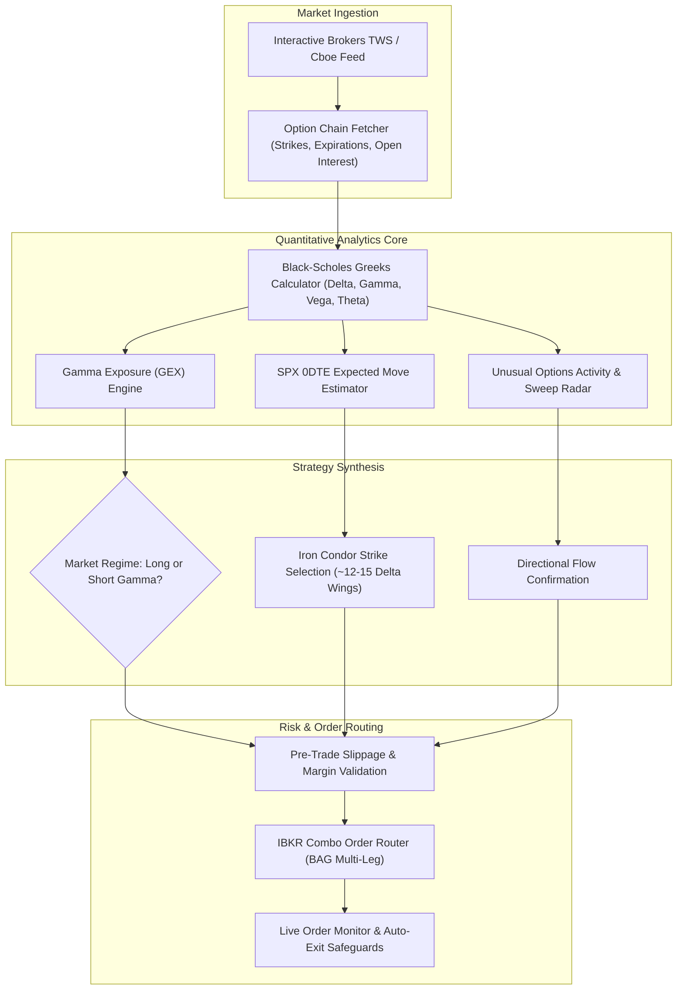
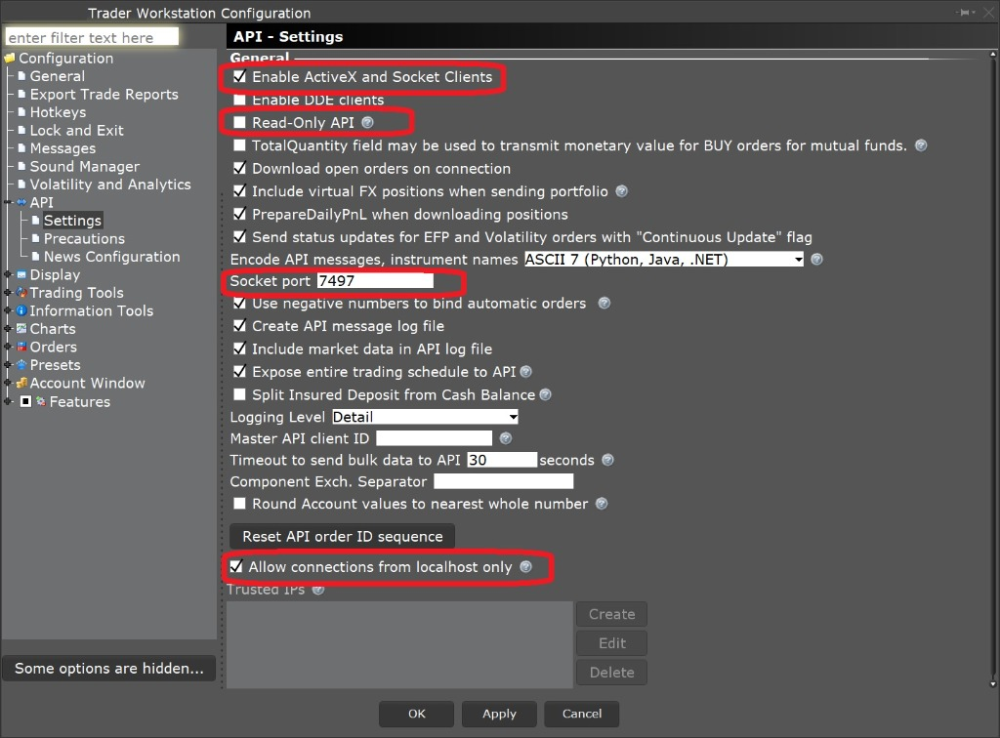

# 🎯 IBKR Options Intelligence & 0DTE Analytics Suite

[](https://python.org)
[](https://interactivebrokers.com)
[](https://github.com/erdewit/ib_insync)
[](https://cboe.com)
[](https://opensource.org/licenses/MIT)

> An institutional-grade options intelligence and quantitative analytics framework built for **Interactive Brokers (IBKR)**. Features real-time **SPX 0DTE expected move scanners**, **Gamma Exposure (GEX) profiling**, dealer zero-gamma flip detection, IV rank and skew surfaces, and automated multi-leg spread execution.

```
┌────────────────────────────────────────────────────────────────────────────────┐
│  🎯 IBKR Options Intelligence Terminal — Real-Time Derivatives Suite           │
│  Target: SPX / SPY / QQQ / Mega-Caps | Gateway: Port 7497 (Paper) / 7496 (Live)│
├────────────────────────────────────────────────────────────────────────────────┤
│  🎯 SPX 0DTE Setup: High-Probability Iron Condor (~76% PoP | Net Credit: $6.50)│
│  🌊 GEX Regime: +$276.86M (LONG_GAMMA_STABILIZING | Zero-Gamma Flip: $582.50)  │
│  ⚡ Flow Radar: 5 High-Conviction Sweeps Detected (NVDA $145C, TSLA $265C)     │
│  🧮 Pricing Engine: Analytical Black-Scholes Closed-Form Greeks (Delta, Gamma) │
└────────────────────────────────────────────────────────────────────────────────┘
```

---

### 💼 Need Custom Options Algorithms, 0DTE Spreads, or Broker API Integrations?
I engineer high-performance options trading software, broker API connectors, risk-management systems, and institutional quantitative algorithms.
* 💬 **Telegram:** [@JanzebBlockdev](https://t.me/JanzebBlockdev)
* 💼 **Fiverr Profile:** [Verified Quantitative Developer (Fiverr)](https://www.fiverr.com/jahanzaib313110)
* 📧 **Email:** `jahanzaibchanna70@gmail.com`

---

## 📑 Table of Contents
1. [Key Architectural Highlights](#-key-architectural-highlights)
2. [Options Decision & Execution Workflow](#-options-decision--execution-workflow)
3. [SPX 0DTE Expected Move & Spread Constructor](#-spx-0dte-expected-move--spread-constructor)
4. [Gamma Exposure (GEX) & Dealer Positioning](#-gamma-exposure-gex--dealer-positioning)
5. [Unusual Options Activity & Flow Radar](#-unusual-options-activity--flow-radar)
6. [Interactive Brokers TWS / Gateway Configuration](#-interactive-brokers-tws--gateway-configuration)
7. [Installation & Quickstart](#-installation--quickstart)
8. [Explore Connected Quantitative Projects](#-explore-connected-quantitative-projects)
9. [Disclaimer](#-disclaimer)

---

## 🚀 Key Architectural Highlights

* **SPX 0DTE Algorithmic Scanner:** Estimates daily standard deviation bounds ($S \times \text{IV} \times \sqrt{\text{DTE}/365}$) and constructs non-directional delta-neutral Iron Condors with defined tail protection.
* **Dealer Gamma Exposure (GEX) Engine:** Aggregates dollar gamma across all strikes to pinpoint the **Zero-Gamma Flip Level** (where dealer hedging switches from volatility dampening to volatility acceleration).
* **Closed-Form Black-Scholes Greeks:** High-speed calculation of Delta ($\Delta$), Gamma ($\Gamma$), daily Theta ($\Theta$), Vega ($\nu$), and Rho ($\rho$).
* **Institutional Flow & Sweep Radar:** Scans option chains for volume-to-open-interest spikes ($V/OI \ge 2.0\times$) and aggressive multi-million-dollar block trades.
* **Multi-Leg Spread Execution:** Supports automated execution for Iron Condors, Vertical Credit Spreads, Butterflies, and Calendar Spreads with execution slippage guards.

---

## 🏛️ Options Decision & Execution Workflow



---

## 🎯 SPX 0DTE Expected Move & Spread Constructor

The scanner continuously computes the statistical expected move over zero-day horizons:

```math
\text{Expected Move} = \text{Spot Price} \times \text{IV} \times \sqrt{\frac{\text{DTE}}{365}}
```

### Automated 0DTE Iron Condor Rules:
* **Short Call Strike:** Set at approximately $12$–$15$ Delta above spot ($\approx \text{Spot} + 1.15 \times \text{Expected Move}$).
* **Short Put Strike:** Set at approximately $12$–$15$ Delta below spot ($\approx \text{Spot} - 1.15 \times \text{Expected Move}$).
* **Long Protective Wings:** Placed $20$–$25$ points outward to enforce defined catastrophic risk.
* **Probability of Profit (PoP):** Systematically targets $\ge 75\%$ win probability.

---

## 🌊 Gamma Exposure (GEX) & Dealer Positioning

Dealers dynamically hedge their aggregate options inventory. GEX identifies key structural support and resistance levels:

```math
\text{Call GEX} = \Gamma_{\text{call}} \times \text{OI}_{\text{call}} \times 100 \times S^2 \times 0.01
```
```math
\text{Put GEX} = \Gamma_{\text{put}} \times \text{OI}_{\text{put}} \times 100 \times S^2 \times 0.01
```
```math
\text{Net GEX} = \sum \text{Call GEX} - \sum \text{Put GEX}
```

* **Positive Net Gamma (Long Gamma):** Dealers buy dips and sell rips, pinning prices and suppressing market volatility.
* **Negative Net Gamma (Short Gamma):** Dealers sell into downturns and buy into rallies, accelerating volatility.
* **Zero-Gamma Flip Point:** The critical price threshold where market behavior abruptly shifts regime.

---

## ⚡ Unusual Options Activity & Flow Radar

Detects institutional positioning before major momentum shifts:
* **Volume / Open Interest Spike:** Triggers on contracts trading at $\ge 2.0\times$ prevailing open interest.
* **Premium Threshold:** Filters out retail retail noise by enforcing minimum notional premium thresholds (\$50,000+).
* **Sweep vs Block Classification:** Identifies aggressive market orders sweeping multiple exchanges simultaneously.

---

## ⚙️ Interactive Brokers TWS / Gateway Configuration

Before running live or paper analysis, configure your local Trader Workstation (TWS) or IB Gateway:

1. Open **TWS** and log in.
2. Navigate to **File $\rightarrow$ Global Configuration $\rightarrow$ API $\rightarrow$ Settings**.
3. Configure the following parameters:
   * ✅ **Enable ActiveX and Socket Clients**
   * Socket Port: `7497` (Paper Trading) or `7496` (Live Trading)
   * Uncheck ❌ **Read-Only API** (if executing multi-leg orders)
   * Check ✅ **Allow connections from localhost only** (or add `127.0.0.1` to Trusted IPs)
4. Click **Apply** and **OK**.

<p align="center">
  
</p>

---

## 🛠️ Installation & Quickstart

1. **Clone the repository:**
   ```bash
   git clone https://github.com/jahanzaib-codes/IBKR-Options-Intelligence.git
   cd IBKR-Options-Intelligence
   ```

2. **Create virtual environment & install requirements:**
   ```bash
   python -m venv .venv
   source .venv/bin/activate  # On Windows: .venv\Scripts\activate
   pip install -r requirements.txt
   ```

3. **Configure Environment:**
   ```bash
   cp .env.example .env
   ```

4. **Launch the Diagnostics & Analytics Suite:**
   ```bash
   python main.py --mode demo
   ```

### Execution Modes:
```bash
python main.py --mode demo  # Runs full 3-phase diagnostic suite
python main.py --mode spx   # Generates live 0DTE Iron Condor setup
python main.py --mode flow  # Scans unusual institutional options flow
```

---

## ⭐ Explore Connected Quantitative Projects

* 🌐 **[OpenTradeAI — Flagship AI Trading Platform](https://github.com/jahanzaib-codes/OpenTradeAI)** — Open-source multi-asset AI quantitative trading platform with multi-agent consensus and deterministic risk gates.
* 📈 **[IBKR AI Options Trading Bot & GUI](https://github.com/jahanzaib-codes/ibkr-ai-trading-bot-gui)** — Desktop options terminal with trained XGBoost classifier and backtesting suite.
* 📉 **[IBKR Automated Trailing Stop Orders](https://github.com/jahanzaib-codes/ibkr-trailing-orders)** — CSV batch trailing stop limit order dispatcher with loss prevention.
* ⚡ **[Solana Pump.fun 0-Block Sniper Bot](https://github.com/jahanzaib-codes/solana-pumpfun-sniper-bot)** — Ultra low-latency meme coin sniper powered by Rust and Jito MEV bundles.
* 🛡️ **[PropFirm MT5 Risk Guardian EA](https://github.com/jahanzaib-codes/propfirm-mt5-risk-guardian)** — Institutional MQL5 risk manager enforcing daily and total drawdown limits for FTMO / FundedNext.

---

## ⚠️ Disclaimer

*This software is designed for quantitative research, derivatives analytics, and educational demonstration purposes. Options trading involves substantial risk of capital loss and is not suitable for all investors. Always validate multi-leg options strategies in paper trading mode before committing live funds.*

---
*Maintained by **Jahanzaib** ([@jahanzaib-codes](https://github.com/jahanzaib-codes))*
